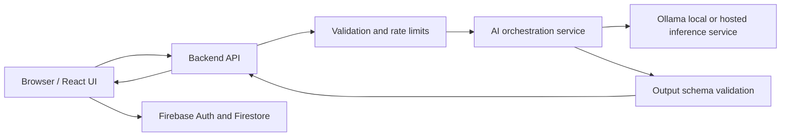

# Gatherly — Architecture

## 1. Goals

- Keep event planning useful without AI.
- Keep AI inference replaceable and isolated behind a service interface.
- Validate user input and model output.
- Keep financial arithmetic deterministic.
- Avoid committing model weights or generated build output.
- Support a Firebase-hosted frontend without pretending Firebase Hosting runs Ollama.

## 2. Logical architecture

The frontend must never contain server secrets or connect directly to an unrestricted public Ollama endpoint. In development, the backend may call Ollama on the same machine. Production requires a secured reachable backend or a clearly disclosed local-only AI mode.

## 3. Frontend

Recommended stack:
- React + TypeScript + Vite.
- Feature-oriented component organization.
- React Router or an equivalent routing approach.
- Accessible form controls and reusable UI primitives.
- A small state-management solution only if local component/context state is insufficient.
- A schema validation library, or equivalent well-tested validators.

Suggested feature boundaries:
- `events`: event CRUD and event workspace.
- `planner`: AI request, draft display, review, and save.
- `budget`: budget categories, expenses, and calculations.
- `tasks`: task CRUD, due dates, and status.
- `vendors`: vendor records and statuses.
- `guests`: guest records and RSVP.
- `calendar`: date-based overview.
- `settings`: preferences, privacy, and AI status.

Keep components presentational where possible. Put API and persistence logic in service modules rather than scattering fetch or Firestore calls throughout the UI.

## 4. Backend

Recommended responsibilities:
- Validate requests and impose request-size limits.
- Authenticate and authorize user-owned resources.
- Apply rate limits to AI endpoints.
- Construct prompts from an allowlisted set of fields.
- Call Ollama with bounded generation settings and timeouts.
- Validate the returned JSON against a schema.
- Return safe, useful errors without exposing internal traces.
- Avoid logging personal event content or secrets.

Suggested endpoints (adapt to the implementation):
- `GET /health` — service health, with no secret details.
- `POST /api/plan` — generate a planning draft.
- `POST /api/plan/validate` — optional schema or preview validation.
- Additional CRUD endpoints only if the chosen persistence design uses the backend.

If the browser accesses Firestore directly, Firestore Security Rules must enforce authentication and ownership. Client-side route guards alone are not authorization.

## 5. Ollama integration

- Configure the model name through server-side environment configuration.
- Use a model that fits the development machine's available RAM and compute.
- Ask for a strict JSON response matching a documented schema.
- Set maximum output tokens or equivalent generation limits, request timeout, and concurrency limits.
- Validate the response after generation; never trust model output.
- Do not assume every Ollama model reliably supports schema-constrained output.
- Do not download or commit model weights into the Git repository.
- Handle unavailable model, malformed output, timeout, and overload states.

## 6. Data model (illustrative)

### Event
- `id`
- `ownerId`
- `name`
- `type`
- `startDate`
- `endDate` (optional)
- `location` (optional)
- `currency`
- `budget`
- `guestCount`
- `preferences`
- `createdAt`
- `updatedAt`

### BudgetCategory
- `id`
- `eventId`
- `name`
- `plannedAmount`
- `actualAmount` (or derive from expenses)
- `notes` (optional)

### Expense
- `id`
- `eventId`
- `categoryId` (optional)
- `description`
- `amount`
- `date`
- `status`

### Task
- `id`
- `eventId`
- `title`
- `dueDate`
- `priority`
- `status`
- `source` (`manual` or `ai_suggestion`)
- `assigneeId` (optional)

### Vendor
- `id`
- `eventId`
- `name`
- `category`
- `contact` (optional)
- `quoteAmount` (optional)
- `status`
- `notes` (optional)

### Guest
- `id`
- `eventId`
- `name`
- `group` (optional)
- `rsvpStatus`
- `attendeeCount`
- `dietaryNotes` (optional)
- `accessibilityNotes` (optional)

Collect only fields needed for the product. Sensitive guest notes require especially careful access control and should not be sent to the AI model by default.

## 7. Persistence and authorization

Two acceptable implementation patterns:

### Pattern A — Client Firebase SDK
Use Firebase Authentication and Firestore from the client. Enforce ownership in Firestore Security Rules. This is suitable for standard CRUD if rules are tested thoroughly.

### Pattern B — Backend-mediated persistence
Use the backend to access data after authenticating the user and authorizing each request. Keep service-account credentials only in the server environment.

Do not combine both patterns casually. Document which layer is authoritative for each operation.

## 8. Deployment topology

- Firebase Hosting serves the built frontend.
- Firebase Authentication and Firestore may provide identity and storage.
- The AI backend runs separately from Firebase Hosting.
- The AI backend reaches Ollama over a private or otherwise appropriately secured network path.
- A local development Ollama instance is not automatically reachable from a public deployment.

For a public demo, either deploy a secured inference backend with appropriate cost and abuse controls, or expose a clearly labeled local demo mode. Do not publish an unprotected Ollama port.

## 9. Configuration

Use `.env.example` to document variable names and safe placeholders. Keep actual environment files out of version control. Public Firebase web configuration may be visible in client bundles; data protection must come from authentication, rules, App Check where appropriate, and server-side controls—not from hiding the web config.

## 10. Architecture decision records

Before implementation, decide and document:
1. Whether sign-in is required for the demo.
2. Whether Firestore is used or the app is a local prototype.
3. Where the AI backend runs in the deployed demo.
4. Which Ollama model is used and its license.
5. What data, if any, is sent to AI inference.
6. How data deletion and export work.
