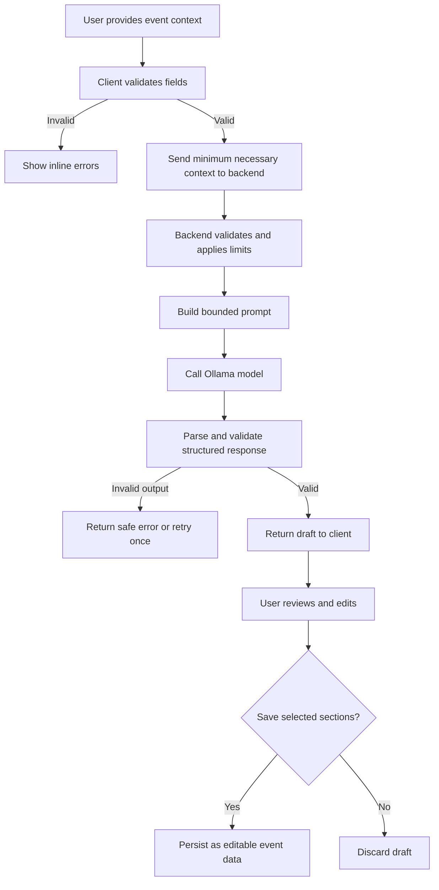

# Gatherly — Application and User Flow

## 1. Primary user journey

1. User opens Gatherly.
2. User lands on the dashboard or onboarding screen.
3. User selects **Create Event**.
4. User enters event basics: name, type, date, location, venue status.
5. User enters planning context: budget, guest count, event style, priorities, and optional constraints.
6. Client validates the form and sends only the necessary fields to the backend.
7. Backend validates the request and constructs a bounded prompt for Ollama.
8. AI returns a structured draft.
9. Backend validates the model response against the expected schema.
10. Client displays the draft with a clear AI-generated disclosure.
11. User reviews, edits, rejects, or saves selected sections.
12. Saved sections become ordinary editable event data.
13. User manages tasks, milestones, budget categories, vendors, and guests.
14. Dashboard progress is calculated from saved data.
15. User can continue planning manually if the AI service is offline.

## 2. Event creation flow

### Required fields

- Event name.
- Event type.
- Event date or date range, where relevant.
- Currency and budget.
- Expected guest count.

Location and preferences should be optional unless the chosen feature depends on them. Validation should explain why a field is required.

### States

- `draft`: user is still entering event details.
- `validating`: client-side validation is running.
- `creating`: event persistence is in progress.
- `created`: event saved successfully.
- `error`: creation failed; retain safe form values and offer retry.

Avoid clearing a completed form after a failed save.

## 3. AI planning flow

The UI must not imply that a plan was saved until persistence succeeds. Model output is untrusted data and must be treated as text, not executable markup.

## 4. Budget flow

1. User sets an overall budget.
2. User creates or accepts suggested categories.
3. Application calculates category totals and remaining amount using numeric values.
4. User records actual expenses separately from estimates.
5. Application displays planned, actual, and remaining values.
6. If a category or overall budget is exceeded, show a text warning as well as a visual indicator.

AI suggestions are estimates. Do not present them as vendor quotes or guaranteed market prices.

## 5. Task and timeline flow

1. User creates a task manually or selects an AI-suggested milestone.
2. User reviews the title, due date, priority, and optional assignee.
3. User confirms and saves the task.
4. Task appears in list, calendar, and event overview.
5. User changes status.
6. Dashboard progress updates from saved task state.

Suggested deadlines must be labeled as suggestions until the user confirms them.

## 6. Vendor flow

1. User adds a vendor manually or creates a vendor research task.
2. User records category, contact details, notes, quote, and status.
3. User updates status through research, contacted, quote received, shortlisted, booked, or rejected.
4. Application displays vendor status and next action.

Unless a real, verified vendor integration exists, the application must not imply that vendor listings, availability, reviews, prices, or contact details have been independently verified.

## 7. Guest and RSVP flow

1. User adds a guest or imports a supported file, if import is implemented.
2. Application validates fields and displays a preview before importing.
3. User records RSVP and attendee count.
4. Guest totals update from saved records.
5. Private guest data remains available only to authorized users.

Avoid sending guest names, phone numbers, email addresses, dietary details, or accessibility notes to the AI service when aggregate counts are sufficient.

## 8. Failure and fallback flows

| Failure | Expected behavior |
|---|---|
| Ollama unavailable | Show service-unavailable state and manual planning options |
| Model timeout | Stop waiting after configured timeout; allow retry |
| Invalid model response | Reject malformed structure; do not persist it automatically |
| Firebase write denied | Show a clear save error; retain recoverable form state |
| Network loss | Explain which actions require connectivity; avoid claiming success |
| Empty dashboard | Show a useful create-event call to action |
| No vendors or guests | Show helpful empty states rather than fake records |
| Session expired | Prompt sign-in again without exposing private data |

## 9. Core navigation

- Overview → event summaries and deadlines.
- My Events → event list and event workspace.
- Calendar → milestones and deadlines.
- Tasks → cross-event task list.
- Guests → guest management for the selected event.
- Vendors → vendor management for the selected event.
- Budget & Expenses → financial tracking.
- AI Planner → generate and review planning drafts.
- Settings → profile, preferences, privacy, and AI status.

Navigation must preserve the selected event context where practical.
